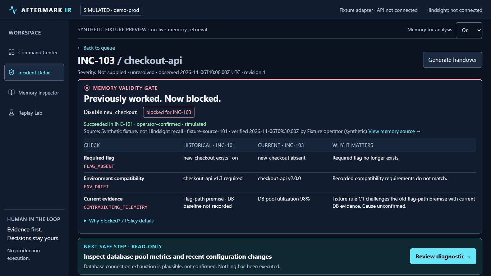

# AFTERMARK IR frontend

Runnable React + TypeScript + Vite + Tailwind implementation of the four-screen UX specification. Default mode is an **explicit synthetic fixture preview**, not a live Hindsight demonstration. No production action can execute. No backend or simulator files were added or modified.

## Run locally

Node 22.12+ (verified with Node 24.14.1) and npm. From the repository root:

```powershell
cd frontend
npm ci
npm run dev
```

Open http://127.0.0.1:5173/incidents/INC-103 for the hero interaction. The queue is `/incidents`, source audit is `/memory?incident=INC-103`, and comparison is `/replay`.

```powershell
npm run typecheck
npm run build
npm test
npm run test:e2e
```

Browser tests use installed Microsoft Edge on Windows. CI uses Playwright Chromium (`CI=true`; install it with `npx playwright install --with-deps chromium`). Playwright starts and stops fixture and HTTP-adapter Vite servers on ports 5173 and 5175. Keep those ports free. The HTTP-adapter tests intercept requests with controlled synthetic responses; they do not establish backend integration.

## What works

- Command Center: bounded incident queue, URL-backed search/status/service filters, unresolved count, real navigation links.
- Incident Detail: shared gate comparison, all three INC-103 reasons, explicit fixture provenance, read-only diagnostic review, idempotent local decision acknowledgement, evidence dialogs, and review/copy handover.
- Memory Inspector: source/trust selection, escaped or quarantined excerpts, captured/verified/retrieved distinctions, missing citation handling, separate provider trace area. **No fabricated provider operations.**
- Replay Lab: scenario preview and paired M0/M2 analysis of the same incident revision. ON includes explicitly synthetic historical context; OFF requests no recall and contains no historical hit. No comparative benchmark is claimed.
- Dark specification tokens; responsive rail/menu, stacked comparisons, native modal focus containment/return, skip link, semantic headings, reduced-motion and forced-colors styles.

## Integration boundary

See [INTEGRATION.md](INTEGRATION.md). There was no OpenAPI file or implementation in this checkout. Zod schemas in `src/types/contracts.ts` are **provisional**, derived from the documented fields and awaiting teammate review. They are not an agreed backend contract.

To test a backend that implements the provisional shapes, create an untracked `.env.local`:

```dotenv
VITE_ADAPTER=http
VITE_API_BASE_URL=http://localhost:8000
```

Restart Vite. HTTP mode never falls back to fixtures on error. CORS must allow the frontend origin. Only public configuration belongs in `VITE_*`; provider credentials belong exclusively in the backend.

## Screenshots and verification

Captured from the running app, not design mockups:



- [Full desktop incident](screenshots/incident-desktop.png)
- [390 px mobile incident](screenshots/incident-mobile.png)
- [Command Center](screenshots/queue-desktop.png)
- [Memory Inspector](screenshots/memory-desktop.png)
- [Replay Lab](screenshots/replay-desktop.png)

See [VERIFICATION.md](VERIFICATION.md) for executed results, corrected failures and remaining verification limits.

## File map

`src/pages/` contains the four screens. `src/components/` contains the shared gate, provenance, timeline, decisions, handover and native dialog. `src/api/client.ts` contains validated HTTP requests and the future event reconciliation helper. `src/api/simulation.ts` is the isolated, explicitly named fixture adapter. `src/api/state.tsx` protects against superseded responses. `src/styles/globals.css` defines tokens and responsive behavior. `tests/` contains adapter safety tests and browser acceptance tests.

## Honest limits

Live retain/recall/reflect, restart persistence, SSE reconciliation against a server, cold learning replay, server-authorized outcome recording, remote handover generation, evaluation reports and real-provider timings are **not connected or proven**. Run controls remain disabled with the precise missing prerequisite. Local decision intent is stored in memory for this browser session only; reloading discards it. No simulated execution or outcome is inferred from approval. Handover is a frontend draft and directs the reader to review local decision acknowledgements separately. No participant interviews or usability sessions were performed, and no full WCAG conformance is claimed.
